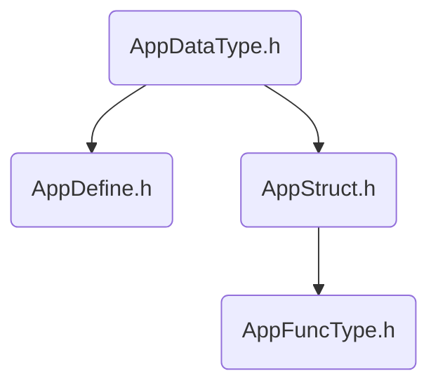
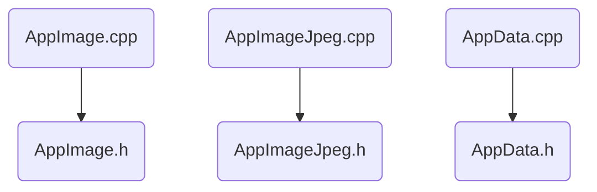
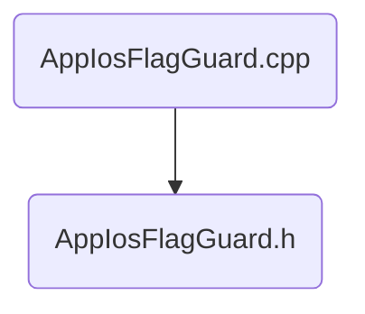
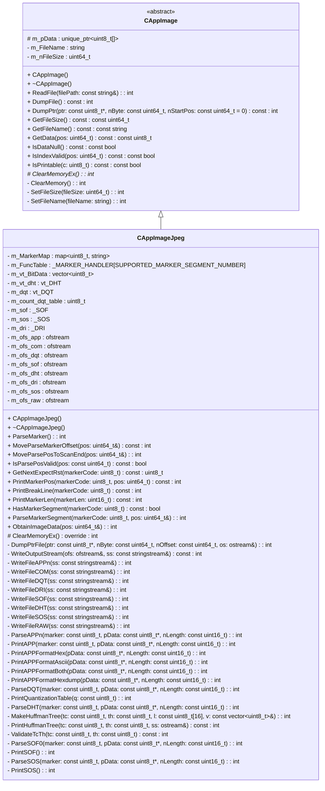
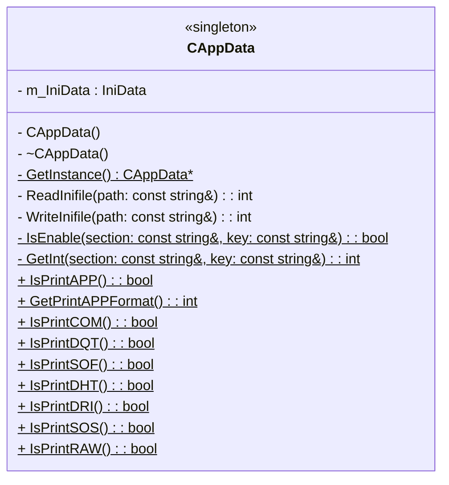
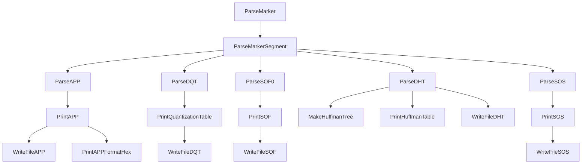

# API Specifications

The project provides the class libraries shown below.
Declared in header (`.h`) and implemented in source (`.cpp`).

|Class|Declared in|Implemented in|
|---|---|---|
|`CAppImage`|`AppImage.h`|`AppImage.cpp`|
|`CAppImageJpeg`|`AppImageJpeg.h`|`AppImageJpeg.cpp`|
|`CAppData`|`AppData.h`|`AppData.cpp`|

## Scope

The project aims to decore **baseline** JPEG files (`SOF0`).
Baseline JPEG has the following features:

- Source image: **8-bit** samples per pixcel per  component
- Compression Method: Huffman Coding
- Max number of Huffman tables: 4 (DC: 2 / AC: 2)

## 1. JPEG File Overview

A JPEG file consists of multiple **segments**.
A **marker segment**, fixed 2-byte data, indicates the start positon of a segment.
A marker segment is followed by a 2-byte length field, and variable length parameters.
A marker segment always starting with `0xFF`, followed by a unique 1-byte value.

For details, please refer to the standardized document: **ITU-T Recommendation T.81** (equivalent to **ISO/IEC 10918-1**), published by the **ITU-T** in **September 1992**.

A copy of the PDF is also mirrored by W3C:

<https://www.w3.org/Graphics/JPEG/itu-t81.pdf>

Official ITU-T page:

<https://www.itu.int/rec/T-REC-T.81-199209-I/en>

### 1.1. Encoding

The process of encoding a JPEG file is carried out through the following steps.

1. Converting RGB to YCbCr
2. Chroma Subsampling
3. DCT (Discrete Cosine Transformation)
4. Quantization
5. Huffman encoding

### 1.2. Decoding

The process of decoding a JPEG file is carried out through the following steps.

1. Converting YCbCr to RGB
2. Chroma Interpolation
3. IDCT (Inverse DCT)
4. Dequantization
5. Huffman decoding

### 1.3. T.B.D

The zig-zag order.


## 2. File Structures

### 2.1. Required Markers

The following markers shall always exist in a JPEG file.

- **SOI** : ***S**tart **O**f **I**mage*
- **DHT** : ***D**efine **H**uffman **T**able*
- **SOF** : ***S**tart **O**f **F**rame*
- **DQT** : ***D**efine **Q**uantization **T**able*
- **SOS** : ***S**tart **O**f **S**can*
- **EOI** : ***E**nd **O**f **I**mage*

Each marker begins with `0xFF`, and after the `0xFF`, a unique marker code appears.
The `SOI's` marker code is `0xD8`, and the `EOI's` is `0xD9`.
To see others, please refer to the table shown below.

|Marker|Value|
|------|-----|
|`SOI`|0xFF D8|
|`DQT`|0xFF DB|
|`SOF0`|0xFF C0 (baseline)|
|`DHT`|0xFF C4|
|`SOS`|0xFF DA|
|`EOI`|0xFF D9|

### 2.2. Optional Markers

The following markers are options and may appear in a JPEG file.

- **APP** : ***A**pplication*
- **DRI** : ***D**efine **R**estart **I**nterval*
- **COM** : ***C**omment Out*

|Marker|Value|
|------|-----|
|`DRI`|0xFF DD|
|`APP0`|0xFF E0|
|`APP1`|0xFF E1|
|`APP2`|0xFF E2|
|`APP3`|0xFF E3|
|`APP4`|0xFF E4|
|`APP5`|0xFF E5|
|`APP6`|0xFF E6|
|`APP7`|0xFF E7|
|`APP8`|0xFF E8|
|`APP9`|0xFF E9|
|`APP10`|0xFF EA|
|`APP11`|0xFF EB|
|`APP12`|0xFF EC|
|`APP13`|0xFF ED|
|`APP14`|0xFF EE|
|`APP15`|0xFF EF|
|`COM`|0xFF FE|

### 2.3. Pre-required Markers

If the `DRI` marker exists in a JPEG file befeore a `SOS` marker, `RSTn` markers are necessary to be btween chunks of several MCUs.

|Marker|Value|
|------|-----|
|`RST0`|0xFF D0|
|`RST1`|0xFF D1|
|`RST2`|0xFF D2|
|`RST3`|0xFF D3|
|`RST4`|0xFF D4|
|`RST5`|0xFF D5|
|`RST6`|0xFF D6|
|`RST7`|0xFF D7|

- **RST** : ***R**estart*

### 2.4. Terms

|Term|Word|Explanation|
|----|:-----------:|---|
|**Marker**|-|2-byte symbol|
|**Segment**|-|A compartment that consits of a JPEG file.|
|**MCU**|***M**inimum **C**oded **U**nit*|The minimum coded unit.|

### 2.5. Markers Without Segments

Markers that do not have a segment are as follows:

- `SOI`
- `EOI`
- `RSTn` (n = 0, 1, 2, 3, 4, 5, 6, 7)

Other markers always have a segment.
The length field includes the 2 bytes of the length field itself.

### 2.6. Special Pudding

#### 2.6.1. Fill Byte

Based on the JPEG specification (ITU-T T.81), an aribitrary number of **fill bytes** (`0xFF`) may precede the marker code byte within a marker's two-byte prefix.

That is, a marker is not required to be encoded as exactly `0xFF <marker code>`; any number of additinal `0xFF` bytes may be inserted immediately before the marker code, and a decoder must skip them when identifying the marker. The following byte sequences are therefore all valid encodings of the same marker:

|Sequence|Marker|
|--------|------|
|`FF D8`|SOI|
|`FF FF D8`|SOI|
|`FF FF FF D8`|SOI|
|`FF C4`|DHT|
|`FF FF C4`|DHT|
|`FF FF FF C4`|DHT|

#### 2.6.2. Byte Stuffing

After the `SOS` marker, image data appers as bit sequences. If bit sequences contains `0xFF` in its data, it might mislead a decoder that it is a start of marker. To avoid this misunderstanding, a redundant one byte `0x00` is inserted exactly after the `0xFF`.

The following example shows that, after an appearance of the marker `RST0` (0xFFD0), `FC FF 00 D5 ...` follows. The `RSTn` marker does not have a segment, and after the `RSTn` marker, compressed scan data follows again. The part `FF 00` is exactly the indication of the byte stuffing. The actual huffman-coded image data is `FC FF D5 ...` instead of `FC FF 00 D5 ...`.

```txt
FF D0 FC FF 00 D5 1A 6D
3A 68 EF 74 9D D2 99 C6
```

### 2.7. Marker Segments

#### 2.7.1 `SOFn`

The `SOF` stands for *Start Of Frame*, and the marker `SOFn` defined in 13 different types. However, the most used header formats are `SOF0` and `SOF2`. `SOFn` shows how image data is compressed and aligned in a file. The relationship between markers and compression methods is shown below.

|Marker|Value|Explanation|
|------|-----|-----------|
|`SOF0`|0xFFC0|Baseline DCT|
|`SOF1`|0xFFC1|Extended Sequential DCT|
|`SOF2`|0xFFC2|Progressive DCT|
|`SOF3`|0xFFC3|Lossless Sequential|
|-|-|-|
|`SOF5`|0xFFC5|Differential Sequential|
|`SOF6`|0xFFC6|Differential Progressive|
|`SOF7`|0xFFC7|Differential Lossless|
|-|-|-|
|`SOF9`|0xFFC9|Extended Sequential Arthmetic|
|`SOF10`|0xFFCA|Progressive Arithmetic|
|`SOF11`|0xFFCB|Lossless Arithmetic|
|-|-|-|
|`SOF13`|0xFFCD|Differential Sequential Arithmetic|
|`SOF14`|0xFFCE|Differential Progressive Arithmetic|
|`SOF15`|0xFFCF|Differential Lossless Arithmetic|

The `SOF4`, `SOF8`, and `SOF12` do not exist since the value for these are reserved.

#### 2.7.2 `SOF0`

The following combination can be plausible.

|Name|Y|Cb/Cr|MCU Size|MCU|
|----|-|-----|---|-----------|
|4:4:4|1:1|1:1|8 x 8|Y(1) + Cb(1) + Cr(1)|
|4:2:2|2:1|1:1|16 x 8|Y(2) + Cb(1) + Cr(1)|
|4:2:0|2:2|1:1|16 x 16|Y(4) + Cb(1) + Cr(1)|
|4:1:1|4:1|1:1|32 x 8|Y(4) + Cb(1) + Cr(1)|
|4:4:0|1:2|1:1|8 x 16|Y(2) + Cb(1) + Cr(1)|

#### 2.7.3 `DRI` (Define Restart Interval)

The marker `DRI` defines in which interval of MCUs the `RSTn` markers appear during compressed scan data.
If this marker appears before `SOS`, the scan data is split by the `RSTn` markers in that interval.

An exmaple of DRI segment is shown below:

```txt
FF DD 00 04 00 FC
```

|Value|Explanation|
|-----|-----------|
|`FF DD`|DRI's marker|
|`00 04`|Length of the DRI segment. Here's 4 bytes.|
|`00 FC`|`Ri`(Restart Interval), Here's 252 MCUs interval.|

In this example, after each 252 MCUs, one `RSTn` marker will be inserted.

## 3. Header and Program Files

### 3.1. General

Four header files are provided to declare macro constant, structure type, function pointer type, and so on.

- `AppDefine.h`
- `AppFuncType.h`
- `AppStruct.h`
- `AppDataType.h`

The relationships between four headers are shown as follows.



## 3.2. Core Files and Classes

|Class|Declared In|Implemented In|
|------|-------|-----|
|`CAppImage`|`AppImage.h`|`AppImage.cpp`|
|`CAppImageJpeg`|`AppImageJpeg.h`|`AppImageJpeg.cpp`|
|`CAppData`|`AppData.h`|`AppData.cpp`|



## 3.3. Miscellaneous Files and Classes

|Class|Declared In|Implemented In|
|-----|------|-------|
|`CAppIosFlagGuard`|`AppIosFlagGuard.h`|`AppIosFlagGuard.cpp`|



## 4. Usage

```cpp
#include <iostream>
#include <vector>
#include "AppImageJpeg.h"

std::vector<string> file_list;

file_list.push_back("image1.jpg");
file_list.push_back("image2.jpg");
file_list.push_back("image3.jpg");

for (const auto &file : file_list) {
  // Parse per JPEG file
  image.ReadFile(file);
  image.ParseMarker();
}
```

### 4.1. Class Diagrams

#### 4.1.1. `CAppImage` and `CAppImageJpeg`



#### 4.1.2. `CAppData`



### 4.2. Function Call Graph



### 4.3. Setting Files

#### `Setting.ini`

```ini
[MARKER_REPORT]
PRINT_APP=1
PRINT_APP_FORMAT=1
PRINT_COM=1
PRINT_DHT=1
PRINT_DQT=1
PRINT_DRI=1
PRINT_RAW=0
PRINT_SOF=1
PRINT_SOS=1
```

|Item|Possible Values|
|----|---------------|
|`PRINT_APP`|0: Do not print APPn<br>1: Do print APPn|
|`PRINT_APP_FORMAT`|1: Hex<br>2: ASCII<br>4: Both<br>8: Hexdump|
|`PRINT_COM`|0: Do not print COM<br>1: Do print COM|
|`PRINT_DHT`|0: Do not print DHT<br>1: Do print DHT|
|`PRINT_DQT`|0: Do not print DQT<br>1: Do print DQT|
|`PRINT_DRI`|0: Do not print DRI<br>1: Do print DRI|
|`PRINT_RAW`|0: Do not print RAW<br>1: Do print RAW|
|`PRINT_SOF`|0: Do not print SOF<br>1: Do print SOF|
|`PRINT_SOS`|0: Do not print SOS<br>1: Do print SOS|

### 4.4. Output Files

After successful build and run, the followinig files could be generated based on the `Setting.ini` and parsed JPEG files.

|File|Content|
|----|-------|
|`APPn.txt`||
|`COM.txt`||
|`DQT.txt`||
|`SOF.txt`||
|`DHT.txt`||
|`DRI.txt`||
|`SOS.txt`||
|`RAW.txt`||
