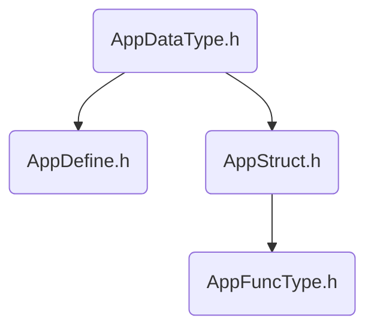
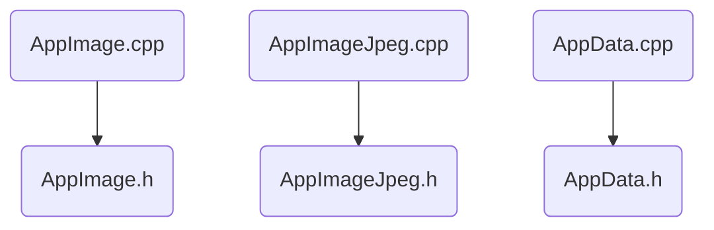
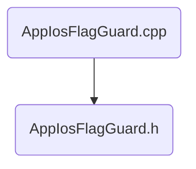
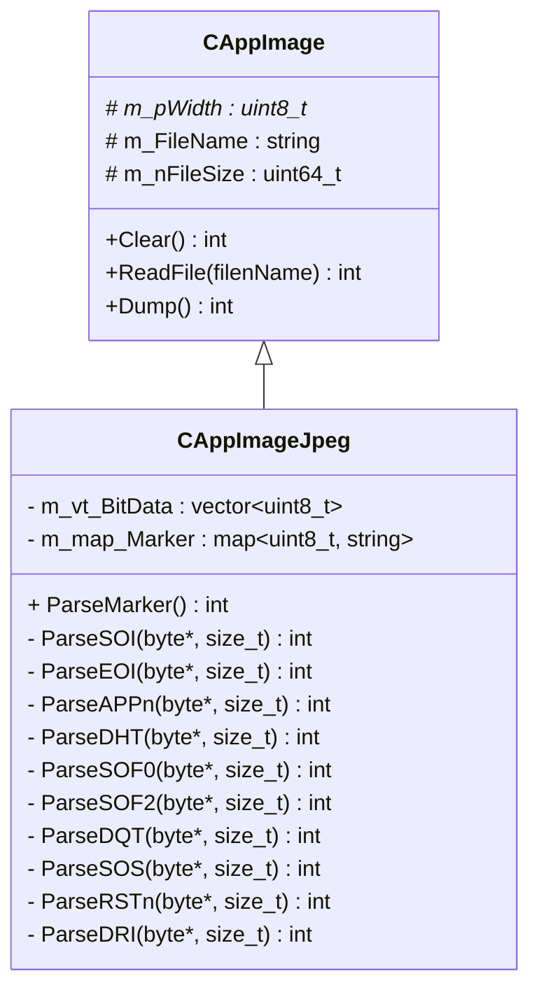
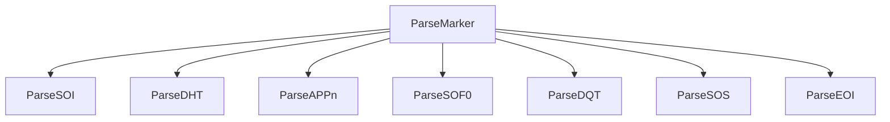

# API Specifications

The project provides the class `CAppImageJpeg`, whose declaration is written in `AppImageJpeg.h`.

## 0. Scope

The class `CAppImageJpeg` is only capable of decoding **baseline sequential** process.

**Baseline sequential** process has the following features:

- Source image: **8-bit** samples within each component
- MAX DHT table: DC: 2, AC: 2

## 1. JPEG File Overview

A JPEG file consists of **segments**. A **marker segment** is the minimum structural unit used in a JPEG file, consisting of a **marker**, a 2-byte length field, and parameters.

To identify each marker segment, a 2-byte identification code called a **marker** is used, always starting with `0xFF`.

To detail, please refer to the standardized document: **ITU-T Recommendation T.81** (equivalent to **ISO/IEC 10918-1**), published by the **ITU-T** in **September 1992**.

A copy of the PDF is also mirrored by W3C:

<https://www.w3.org/Graphics/JPEG/itu-t81.pdf>

Official ITU-T page:

<https://www.itu.int/rec/T-REC-T.81-199209-I/en>

### 1.1. Encode & Decode

The process of encoding a JPEG file is carried out through the following steps.

1. Convert RGB to YCbCr
2. Chroma Subsampling
3. DCT (Discrete Cosine Transformation)
4. Quantization
5. Huffman Encode

The zig-zag order.


## 2. File Structures

### 2.1. Required Segments

The following markers shall always exist in a JPEG file.

- **SOI** : ***S**tart **O**f **I**mage*
- **DHT** : ***D**efine **H**uffman **T**able*
- **SOF** : ***S**tart **O**f **F**rame*
- **DQT** : ***D**efine **Q**uantization **T**able*
- **SOS** : ***S**tart **O**f **S**can*
- **EOI** : ***E**nd **O**f **I**mage*

Each marker begins with `0xFF`, and after the `0xFF`, a unique marker code appears.
The `SOI's` marker code is `0xD8`, while the `EOI's` is `0xD9`.
To see others, please refer to the table shown below.

|Marker|Value|
|------|-----|
|`SOI`|0xFFD8|
|`DHT`|0xFFC4|
|`SOF0`|0xFFC0|
|`SOF2`|0xFFC2|
|`DQT`|0xFFDB|
|`SOS`|0xFFDA|
|`EOI`|0xFFD9|

### 2.2. Optional Segments

The following segments optionally appear in a JPEG file.

- **APP** : ***A**pplication*
- **DRI** : ***D**efine **R**estart **I**nterval*

### 2.3. Pre-required Segments

If a `DRI` marker appers in a JPEG file befeore a `SOS` marker,
the `RSTn` markers are required to be inserted during the bit sequences of image data.

- **RST** : **Restart**

### 2.4. Terms

|Term|Word|Explanation|
|----|-----------|---|
|**Marker**|-|-|
|**Segment**|-|-|
|**MCU**|***M**inimum **C**ode **U**nit*|-|

### 2.5. Markers

Marker that do not have a segment payload:

`SOI`, `EOI`, `RSTn` (n={0,1,2,3,4,5,6,7})

Other markers always have a segment payload and payload field of 2 bytes. Length includes the 2 bytes of the length field itself.

#### 2.5.1. Fill Byte

Per the JPEG specification (ITU-T T.81), an aribitrary number of **fill bytes** (`0xFF`) may precede the marker code byte within a marker's two-byte prefix.

That is, a marker is not required to be encoded as exactly `0xFF <marker code>`; any number of additinal `0xFF` bytes may be inserted immediately before the marker code, and a decoder must skip them when identifying the marker.
The following byte sequences are therefore all valid encodings of the same marker:

|Sequence|Marker|
|--------|------|
|`FF D8`|SOI|
|`FF FF D8`|SOI|
|`FF FF FF D8`|SOI|
|`FF C4`|DHT|
|`FF FF C4`|DHT|
|`FF FF FF C4`|DHT|

#### 2.5.2. Byte Stuffing

After the `SOS` marker, image data appers as bit sequences.
If bit sequences contains `0xFF` in its data, it might mislead a decoder that it is a start of marker.
To avoid this misunderstanding, a redundant one byte `0x00` is inserted exactly after the `0xFF`.

The following example shows that, after an appearance of the marker `RST0` (0xFFD0), `FC FF 00 D5 ...` follows.
The `RSTn` marker do not have a segment payload, and after `RSTn` marker, compressed scan data follows.
The part `FF 00` is exactly the indication of byte stuffing.
The actual huffman-coded image data is `FC FF D5 ...` though.
To avoid such a misunderstanding for a JPEG decoder, it appers as `FC FF 00 D5 ...` in the bit sequences of image data.

```txt
FF D0 FC FF 00 D5 1A 6D
3A 68 EF 74 9D D2 99 C6
```

### 2.6. Marker Segments

#### 2.6.1 `SOFn`

The marker `SOFn` is also required one number. However, the most used compression method  in a real world and its marker is `SOF0` and `SOF2`. This indicator shows how image data is compressed in a file. The relationship between markers and compression methods is shown below.

|Marker|Value|Explanation|
|------|-----|-----------|
|`SOF0`|0xFFC0|Baseline DCT|
|`SOF1`|0xFFC1|Extended Sequential DCT|
|`SOF2`|0xFFC2|Progressive DCT|
|`SOF3`|0xFFC3|Lossless Sequential|
|-|-|-|
|`SOF5`|0xFFC5|Differential Sequential|
|`SOF6`|0xFFC6|Differential Progressive|
|`SOF7`|0xFFC7|Differential Lossless|
|-|-|-|
|`SOF9`|0xFFC9|Extended Sequential Arthmetic|
|`SOF10`|0xFFCA|Progressive Arithmetic|
|`SOF11`|0xFFCB|Lossless Arithmetic|
|-|-|-|
|`SOF13`|0xFFCD|Differential Sequential Arithmetic|
|`SOF14`|0xFFCE|Differential Progressive Arithmetic|
|`SOF15`|0xFFCF|Differential Lossless Arithmetic|

The `SOF4`, `SOF8`, and `SOF12` do not exist since the value for these are reserved.

#### 2.6.2 `DRI` (Define Restart Interval)

The marker `DRI` defines in which interval of MCUs the `RSTn` markers appear during compressed scan data.
If this marker appears before `SOS`, the scan data is split by the `RSTn` markers in that interval.

An exmaple of DRI segment is shown below:

```txt
FF DD 00 04 00 FC
```

|Value|Explanation|
|-----|-----------|
|`FF DD`|DRI's marker|
|`00 04`|Length of the DRI segment. Here's 4 bytes.|
|`00 FC`|`Ri`(Restart Interval), Here's 252 MCUs interval.|

In this example, after each 252 MCUs, one `RSTn` marker will be inserted.

## 3. Header and Program Files

### 3.1. General

Four header files are provided to declare macro constant, structure type, function pointer type, and so on.

- `AppDefine.h`
- `AppFuncType.h`
- `AppStruct.h`
- `AppDataType.h`

The relationships between four headers are shown as follows.



## 3.2. Core Files and Classes

|Header|Program|Class|
|------|-------|-----|
|`AppImage.h`|`AppImage.cpp`|`CAppImage`|
|`AppImageJpeg.h`|`AppImageJpeg.cpp`|`CAppImageJpeg`|
|`AppData.h`|`AppData.cpp`|`CAppData`|



## 3.3. Miscellaneous Files and Classes

|Header|Program|Class|
|------|-------|-----|
|`AppIosFlagGuard.h`|`AppIosFlagGuard.cpp`|`CAppIosFlagGuard`|



## 4. Usage

```cpp
#include <iostream>
#include <vector>
#include "AppImageJpeg.h"

using namespace std;

vector<string> file_list;

// TODO: set files into `file_list`

for (const auto &file : file_list) {
  // Parse per JPEG file
  image.ReadFile(file);
  image.ParseMarker();
}
```

### 4.1. Class Diagrams



### 4.2. Function Call Graph



### 4.3. Setting Files

#### `Setting.ini`

```ini
[MARKER_REPORT]
PRINT_APP=1
PRINT_COM=1
PRINT_DHT=1
PRINT_DQT=1
PRINT_DRI=1
PRINT_RAW=1
PRINT_SOF=1
PRINT_SOS=1
```
